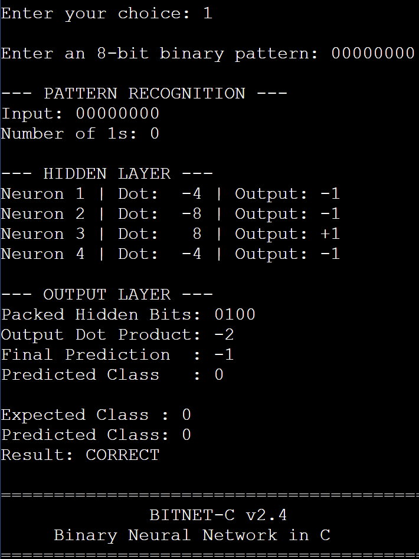
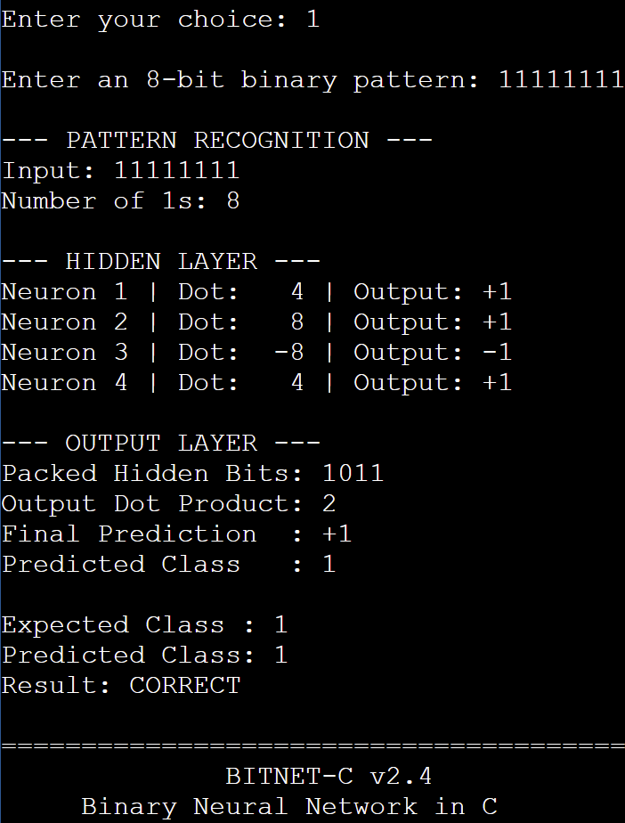
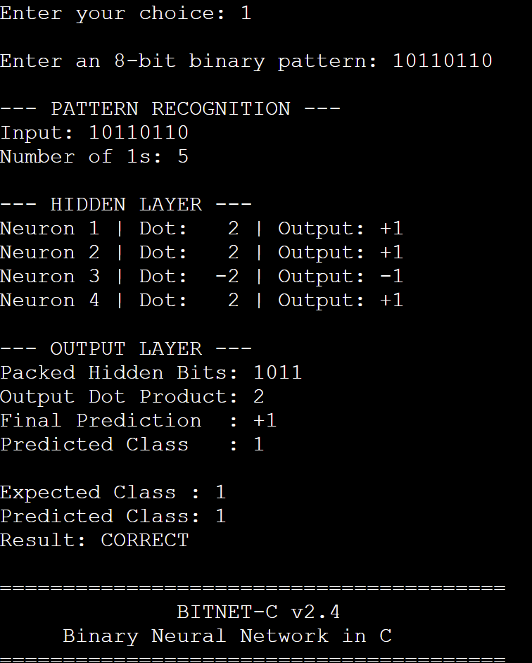
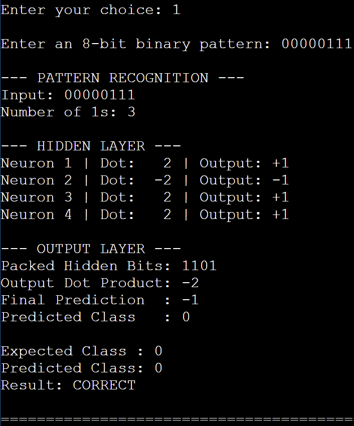

# BitNet-C

### A Bitwise Optimized Binary Neural Network for Ultra Low Memory Activation

**BitNet-C v2.4** is a lightweight, memory-efficient binary neural network developed entirely in C. It demonstrates how binary weight representation, packed activations, XNOR-based calculations, and discrete weight optimization can reduce neural-network storage requirements compared with conventional 32-bit floating-point implementations.

The project was developed by **Team Amateurs (Team 11, Batch 10)** for the First-Year B.Tech C Programming Mini Hackathon at UPES, Dehradun.

## Problem Statement

**BitNet-C: A Bitwise Optimized Binary Neural Network for Ultra Low Memory Activation**

Conventional neural networks commonly use 32-bit floating-point values for storing weights and activations, increasing memory requirements.

The objective of BitNet-C is to design and implement a binary neural network in C that uses bitwise operations and compact binary representations to minimize weight and activation storage while supporting functional inference, optimization, and performance evaluation.

## Project Objectives

- Develop a functional binary neural network using C.
- Implement XNOR and population-count-based binary dot products.
- Minimize weight and hidden activation storage.
- Optimize binary weights using a training algorithm.
- Classify 8-bit binary patterns.
- Evaluate classification accuracy on training and test partitions.
- Compare binary inference with a float32 reference implementation.
- Implement model saving and loading using C file handling.
- Provide an interactive terminal interface and neural-network visualizer.

## Key Features

- **Pure C implementation:** Uses standard C libraries without external machine-learning frameworks.
- **Binary neural network:** An 8 → 4 → 1 feedforward architecture.
- **XNOR-based computation:** Binary dot products using bitwise XNOR and population counting.
- **Compact weight storage:** Stores 36 binary weights in 5 bytes.
- **Packed activations:** Stores four hidden-neuron activations in one byte.
- **Binary weight optimization:** Uses bit-flip hill climbing with multiple random restarts.
- **Pattern recognition:** Classifies 8-bit binary patterns.
- **Accuracy evaluation:** Measures training, test, and overall classification accuracy.
- **Stratified dataset split:** Uses 192 training patterns and 64 test patterns.
- **Float32 reference implementation:** Verifies agreement with the binary inference engine.
- **Performance benchmarking:** Compares execution times over 1,000,000 inference iterations.
- **Model persistence:** Saves and loads optimized weights using binary file handling.
- **Neural network visualizer:** Displays neuron weights, XNOR results, activations, and predictions.
- **Interactive terminal dashboard:** Provides 12 menu options.

## Network Architecture

```text
                INPUT LAYER
                  8 Bits
                     |
                     v
              HIDDEN LAYER
             4 Binary Neurons
                     |
              XNOR + Popcount
                     |
              Binary Activation
                     |
                     v
             Packed Activations
                  1 Byte
                     |
                     v
               OUTPUT LAYER
              1 Binary Neuron
                     |
                     v
               Class 0 / 1
```

**Architecture:** 8 → 4 → 1

**Total Weights:** 36

**Weight Representation:** +1 / −1

**Activation Function:** Binary Sign Function

**Binary Weight Storage:** 5 bytes

**Hidden Activation Storage:** 1 byte

### Architecture Flowchart


## How BitNet-C Works

1. The user enters an 8-bit binary pattern.
2. The program validates and converts the input into an unsigned 8-bit integer.
3. Four hidden neurons perform XNOR-based binary dot-product calculations.
4. Each hidden neuron produces a +1 or −1 activation.
5. The four hidden activations are packed into a single byte.
6. The output neuron processes these activations and generates a binary prediction.
7. The prediction is compared with the expected classification.
8. The program can evaluate accuracy, compare memory usage, benchmark inference, and visualize the network.

### Binary Dot Product Formula

```text
Binary Dot Product = 2 × Popcount(XNOR(A, B)) − N
```

Where `A` represents input bits, `B` represents binary weights, and `N` represents the number of valid bits.

### Binary Activation Function

```text
If dot product >= 0:
    Activation = +1
Else:
    Activation = -1
```

## Binary Pattern Classification

BitNet-C v2.4 classifies 8-bit binary inputs according to the number of set bits.

| Condition | Classification |
|---|---|
| Fewer than four `1` bits | Class 0 |
| Four or more `1` bits | Class 1 |

### Example Inputs

| Binary Input | Number of 1s | Expected Class |
|---|---:|---|
| `00000000` | 0 | 0 |
| `00000111` | 3 | 0 |
| `00001111` | 4 | 1 |
| `10110110` | 5 | 1 |
| `11111111` | 8 | 1 |

The classification rule is used to generate reference labels. The neural network independently generates predictions using its binary weights.

## Training and Weight Optimization

BitNet-C uses **bit-flip hill climbing with multiple random restarts** to optimize binary neural-network weights.

The algorithm:

1. Initializes binary weights.
2. Evaluates classification accuracy on training examples.
3. Flips individual weight bits.
4. Retains changes that improve training performance.
5. Repeats optimization across multiple random restarts.
6. Restores the best-performing discovered weights.

This is a discrete optimization algorithm rather than gradient-based backpropagation.

### Dataset Distribution

| Category | Training | Testing |
|---|---:|---:|
| Class 0 | 70 | 23 |
| Class 1 | 122 | 41 |
| Total | 192 | 64 |

The dataset uses a deterministic shuffled, stratified 75:25 split.

The test partition is excluded from weight optimization.

## Classification Accuracy

During BitNet-C v2.2 testing, the optimized network achieved the following results on the defined 8-bit classification task:

| Metric | Observed Result |
|---|---:|
| Training Accuracy | 100.00% |
| Test Accuracy | 100.00% |
| Overall Accuracy | 100.00% |
| Correct Predictions | 256/256 |
| Incorrect Predictions | 0 |

These results were obtained on a small, fully enumerable classification task. They do not establish performance on unrelated datasets or general-purpose AI tasks.

The final v2.4 implementation retains the same training and evaluation approach. Final-version results should be reconfirmed before submission.

## Memory Optimization

BitNet-C reduces storage requirements by representing neural-network weights and hidden activations using binary values.

| Component | Float32 Storage | Binary Storage | Reduction |
|---|---:|---:|---:|
| Network Weights | 144 bytes | 5 bytes | 96.53% |
| Hidden Activations | 16 bytes | 1 byte | 93.75% |

These figures describe weight and activation storage representations rather than total process RAM consumption.

## Model Saving and Loading

BitNet-C supports saving optimized neural-network weights to a binary file.

**Filename:** `bitnet_model.dat`

### Model File Structure

```text
Signature: BNC1          4 bytes
Hidden Neuron Weights    4 bytes
Output Neuron Weight     1 byte

Total File Size          9 bytes
```

The program validates the file signature, expected size, and output-weight range before restoring the saved weights.

File persistence between OnlineGDB sessions depends on the platform's file-storage behavior.

## Technologies Used

- C Programming Language
- GCC Compiler
- Standard C Libraries
- Bitwise Operations
- Binary Neural Networks
- OnlineGDB
- Git and GitHub

### C Programming Concepts Demonstrated

Functions, arrays, loops, conditional statements, pointers, fixed-width integers, bitwise operators, string handling, file handling, and menu-driven programming.

## Getting Started

### Requirements

A C11-compatible compiler such as GCC.

No external machine-learning frameworks are required.

### Compile

```bash
gcc -std=c11 -O2 main.c -o bitnet
```

### Run on Linux/macOS

```bash
./bitnet
```

### Run on Windows

```bash
gcc -std=c11 -O2 main.c -o bitnet.exe
```

```powershell
.\bitnet.exe
```

Alternatively, open `main.c` in OnlineGDB, select C as the programming language, and click **Run**.

## Interactive Terminal Menu

```text
========================================
              BITNET-C v2.4
     Binary Neural Network in C
========================================

              MAIN MENU

  1. Run Binary Pattern Recognition
  2. Compare Memory Usage
  3. Run Performance Benchmark
  4. Verify Network Correctness
  5. Display Network Architecture
  6. Train / Optimize Binary Weights
  7. Evaluate Classification Accuracy
  8. Display Dataset Information
  9. Save Optimized Model
 10. Load Saved Model
 11. Neural Network Visualizer
 12. Exit

========================================
Enter your choice:
```

**Recommended demonstration sequence:** Train the model using option 6, evaluate using option 7, test a binary pattern using option 1, and explore the visualizer using option 11.

## Sample Execution

**Input:**

```text
10110110
```

**Observed Output:**

```text
--- OUTPUT LAYER ---
Packed Hidden Bits: 1011
Output Dot Product: 2
Final Prediction  : +1
Predicted Class   : 1

Expected Class : 1
Predicted Class: 1
Result: CORRECT
```

## Correctness Verification

The program compares the predictions of the binary implementation with an equivalent float32 reference implementation across all 256 possible 8-bit inputs.

Expected output:

```text
--- CORRECTNESS VERIFICATION ---
Patterns Tested : 256
Mismatches      : 0
Status          : PASS
```

This test measures computational agreement between implementations, not classification accuracy against labels.

## Performance Benchmarking

The program performs 1,000,000 inference iterations for each implementation and reports CPU execution times.

The performance ratio is calculated as:

```text
Performance Ratio = Float32 Time / Binary Time
```

Actual results depend on compiler optimization, processor architecture, and runtime conditions. Binary inference is not guaranteed to be faster in every environment.

## Test Cases and Validation

Detailed test cases, actual outputs, and screenshot evidence are available in:

**[TEST_CASES.md](TEST_CASES.md)**

### Verified Functional Tests

| Test | Input | Result |
|---|---|---|
| TC-01 | `00000000` | PASS |
| TC-02 | `11111111` | PASS |
| TC-03 | `10110110` | PASS |
| TC-04 | `00000111` | PASS |
| TC-06 | `10112010` | PASS — Invalid input rejected |

### Test Execution Screenshots










## Algorithm and Documentation

The complete algorithm, pseudocode, and implementation explanations are available in:

**[ALGORITHM.md](ALGORITHM.md)**

The program flowchart is available in:

**[flowchart.png](flowchart.png)**

## Current Limitations

- Supports 8-bit binary input patterns.
- Uses a small 8 → 4 → 1 network architecture.
- Training uses discrete bit-flip optimization rather than backpropagation.
- Classification is limited to the defined binary-pattern task.
- Memory comparisons focus on weight and activation storage rather than total process memory.
- Benchmark results depend on the execution environment.
- The project is a BitNet-inspired binary neural-network prototype, not an implementation of Microsoft's BitNet architecture.

## Future Enhancements

- Support larger binary input patterns and neural-network architectures.
- Implement additional classification datasets.
- Add hardware-optimized population-count operations.
- Measure peak process memory consumption.
- Improve model persistence across development environments.
- Explore deployment on embedded and resource-constrained devices.

---

## Project Team

**Team Name:** Amateurs

**Team Number:** 11

**Batch:** 10

**Institution:** University of Petroleum and Energy Studies (UPES), Dehradun

**Department:** Computer Science and Engineering

**Event:** First-Year B.Tech C Programming Mini Hackathon

| Team Member | SAP ID | Role |
|---|---|---|
| **Nimit** | **590033868** | **Team Lead & Lead Developer** |
| **Pranav Bhasin** | **590032768** | **Testing & Validation Coordinator** |
| **Abhimanyu Jakhar** | **590032062** | **Research & Analysis Coordinator** |
| **Aasma Sharda** | **590032474** | **Documentation & Presentation Coordinator** |

### Project Lead & Repository Maintainer

**Nimit**

B.Tech Computer Science and Engineering  
University of Petroleum and Energy Studies (UPES)

**Role:** Team Lead, Lead Developer & GitHub Repository Maintainer

**GitHub:** [realnimit1-byte](https://github.com/realnimit1-byte)

**Repository:** [BitNet-C](https://github.com/realnimit1-byte/BitNet-C)

### Acknowledgement

BitNet-C was developed by Team Amateurs as part of the First-Year B.Tech C Programming Mini Hackathon at UPES.

The project demonstrates C programming fundamentals, bitwise computation, binary neural-network inference, memory-efficient representations, algorithmic optimization, and collaborative software development.

The repository is maintained by the Team Lead and contains the implementation, technical documentation, testing evidence, and supporting project materials.

## License

This project is licensed under the MIT License. See the [LICENSE](LICENSE) file for details.

---

**© 2026 BitNet-C Project Team | Team Amateurs — Team 11, Batch 10**

*Developed in C • Optimized with Bitwise Operations • Designed for Memory-Efficient Neural Network Inference*
